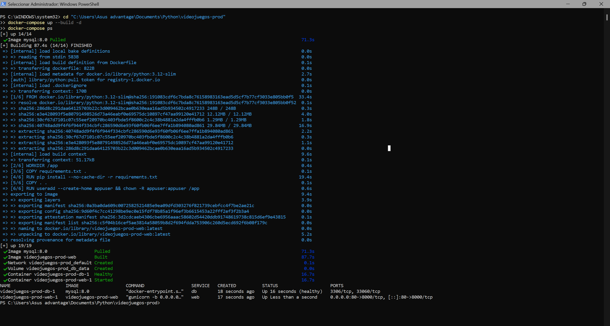
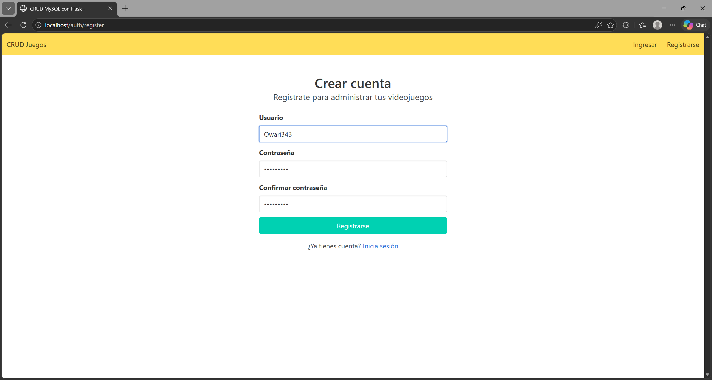
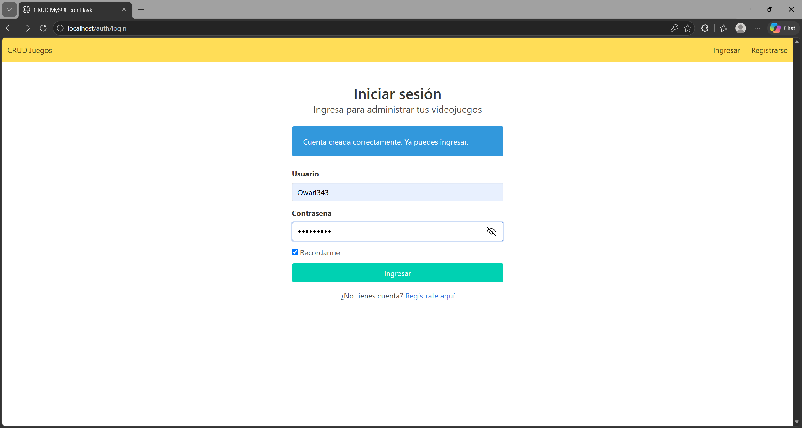
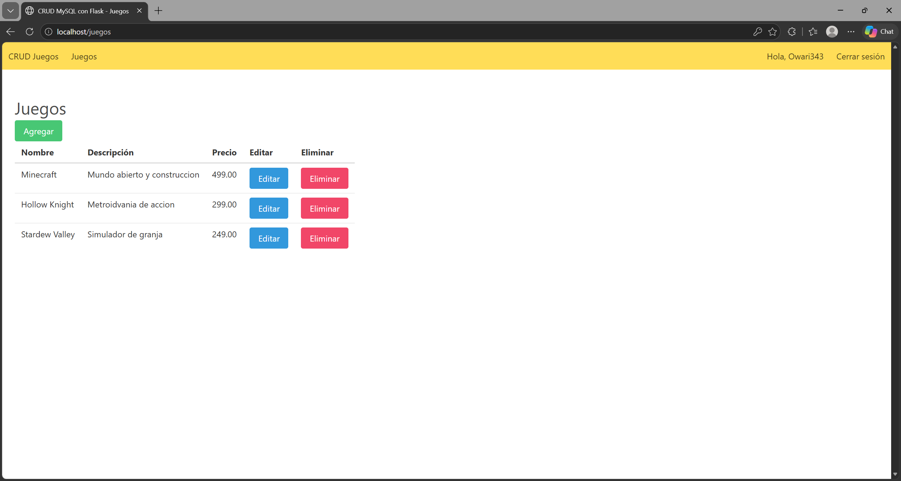
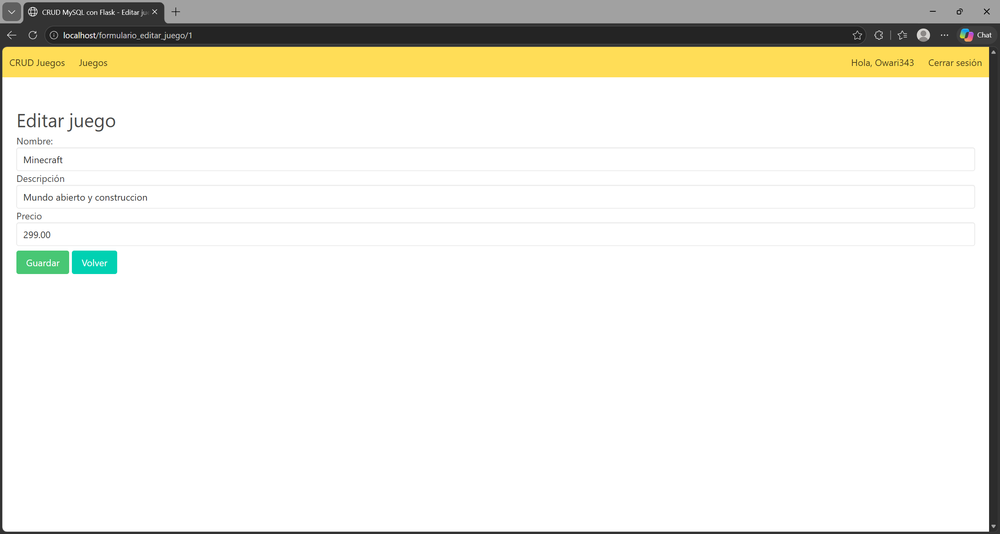

[](https://github.com/carlomederos/videojuegos-prod/actions/workflows/ci.yml)

# Videojuegos - Despliegue de producción

Mini‑sistema de videojuegos hecho con Flask: tiene registro e inicio de sesión (Flask-Login) y CRUD de juegos. En producción corre con **Gunicorn** dentro de un contenedor Docker y usa **MySQL 8** como base de datos, orquestados con **Docker Compose**.

## Estructura

```
videojuegos-prod/
├── app.py               # aplicación Flask (lee DATABASE_URL y SECRET_KEY de os.environ)
├── models.py            # modelos Juego y User
├── controllers.py       # operaciones CRUD
├── auth/                # blueprint de registro / login / logout
├── api/                 # API REST /api/juegos
├── templates/           # vistas Jinja2
├── tests/               # pruebas unitarias (pytest)
├── requirements.txt
├── Dockerfile           # imagen de producción con Gunicorn
├── docker-compose.yml   # servicios web (Flask) + db (MySQL)
└── .env.example         # plantilla de variables de entorno
```

## Variables de entorno

| Variable | Servicio | Descripción | Valor por defecto |
|---|---|---|---|
| `DATABASE_URL` | web | Cadena de conexión SQLAlchemy a MySQL | `mysql+pymysql://user:pwd@db/videojuegos` |
| `SECRET_KEY` | web | Clave para firmar las cookies de sesión de Flask-Login | `cambia_esta_clave` |
| `FLASK_ENV` | web | Modo de ejecución (definida en el Dockerfile) | `production` |
| `MYSQL_ROOT_PASSWORD` | db | Contraseña del usuario root de MySQL | `rootpwd` |
| `MYSQL_DATABASE` | db | Base de datos que se crea al iniciar | `videojuegos` |
| `MYSQL_USER` | db | Usuario de la aplicación | `user` |
| `MYSQL_PASSWORD` | db | Contraseña del usuario de la aplicación | `pwd` |

`app.py` las lee con `os.environ.get(...)`. Para cambiarlas sin tocar `docker-compose.yml`, copia `.env.example` como `.env` y edita los valores; Docker Compose lee ese archivo automáticamente. El `.env` está en `.gitignore`, así que no se sube al repositorio.

## Pasos para levantar la aplicación en producción

Requisito: tener instalado [Docker Desktop](https://www.docker.com/products/docker-desktop/) (incluye Docker Compose).

1. Clonar el repositorio:
   ```bash
   git clone https://github.com/carlomederos/videojuegos-prod.git
   cd videojuegos-prod
   ```
2. (Opcional, recomendado) Configurar secretos propios:
   ```bash
   cp .env.example .env
   # editar .env y poner una SECRET_KEY larga, por ejemplo:
   python -c "import secrets; print(secrets.token_hex(32))"
   ```
3. Construir las imágenes y levantar los contenedores en segundo plano:
   ```bash
   docker-compose up --build -d
   ```
4. Abrir **http://localhost** en el navegador.
5. Probar el flujo: registrarse en *Registrarse*, iniciar sesión, agregar un juego, editarlo y eliminarlo.

Al arrancar, la aplicación espera a que MySQL esté listo (healthcheck en Compose más reintentos en `app.py`) y crea las tablas `users` y `juegos` con `db.create_all()`.

## Comandos Docker / Docker Compose usados

| Comando | Para qué |
|---|---|
| `docker-compose up --build -d` | Construye la imagen `web` y levanta `web` y `db` en segundo plano |
| `docker-compose ps` | Muestra el estado de los contenedores (el de `db` debe aparecer como `healthy`) |
| `docker-compose logs -f web` | Muestra los logs de Gunicorn y de la app |
| `docker-compose exec db mysql -u user -ppwd videojuegos -e "SHOW TABLES;"` | Verifica que se crearon las tablas en MySQL |
| `docker-compose down` | Detiene y elimina los contenedores (los datos se quedan en el volumen `db_data`) |
| `docker-compose down -v` | Lo mismo, pero también borra el volumen con los datos |

## Detalles del despliegue

### Dockerfile

- Parte de `python:3.12-slim`, una imagen ligera. Se usa 3.12 en lugar de 3.9 porque SQLAlchemy 2.1, que viene en `requirements.txt`, ya no es compatible con Python 3.9.
- Copia `requirements.txt` antes que el código, así la capa de dependencias queda en caché y no se reinstala con cada cambio en el código.
- Instala con `pip install --no-cache-dir` para que la imagen pese menos.
- `.dockerignore` deja fuera `venv/`, `.git/`, las pruebas, los logs y otros archivos que no se necesitan en producción.
- El contenedor corre con un usuario sin privilegios (`appuser`), no como root.
- Se sirve con Gunicorn (`gunicorn -b 0.0.0.0:8000 --workers 3 --preload app:app`). `--preload` carga la app una sola vez, así las tablas se crean una vez y no hay una carrera entre los workers.

### docker-compose.yml

- **db**: MySQL 8.0 con un volumen persistente `db_data` y un `healthcheck` con `mysqladmin ping`.
- **web**: se construye desde el `Dockerfile`, publica el puerto `80` del host hacia el `8000` del contenedor y usa `depends_on` con `condition: service_healthy`, así solo arranca cuando MySQL ya acepta conexiones.
- Dentro de la red de Compose, la app se conecta a MySQL con el nombre de host `db`.
- El driver es PyMySQL; también se instala `cryptography` porque MySQL 8 usa la autenticación `caching_sha2_password`.

### Flask-Login y sesiones bajo Gunicorn

Las sesiones de Flask se guardan en una cookie firmada con `SECRET_KEY`. Como los 3 workers de Gunicorn leen la misma `SECRET_KEY` de la variable de entorno, cualquier worker valida la sesión y el usuario sigue autenticado sin importar qué worker atienda la petición. Por eso la clave no puede generarse al azar en cada proceso.

## Capturas de pantalla

> Las imágenes van en `docs/capturas/`.

**Contenedores en ejecución (`docker-compose ps`)**



**Registro de usuario**



**Inicio de sesión**



**Listado de videojuegos**



**Crear videojuego**


**Editar videojuego**



## Pruebas

Las pruebas usan SQLite en memoria y se ejecutan en GitHub Actions con cada push:

```bash
pip install -r requirements.txt pytest pytest-cov
python -m pytest --cov=. tests/
```
